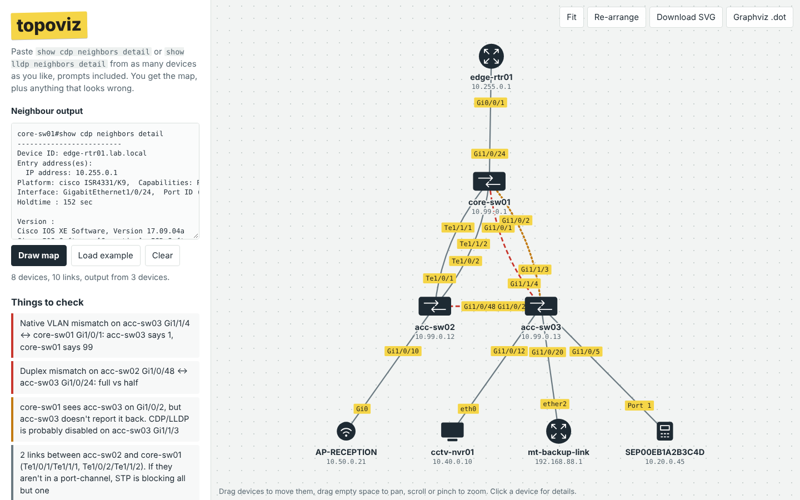

# topoviz

Paste `show cdp neighbors detail` / `show lldp neighbors detail` output from your switches and routers and get a network diagram. Port labels on every cable, plus a list of things that look wrong.

**Live: https://greatslab.github.io/topoviz/**



## Why

Every network I've walked into had one of two diagrams: none, or a Visio from three years ago that's wrong. CDP and LLDP already know the real topology. The switches tell you exactly who's plugged in where, but only one box at a time, in a wall of text.

So you SSH to five switches, run the same command on each, paste it all into one box here, and you have the map in a minute. It's also a quick way to catch the classic misconfigs while you're at it.

## What it checks

| Check | How it knows |
|---|---|
| **Native VLAN mismatch** | both ends report a native VLAN and they differ (CDP only) |
| **Duplex mismatch** | both ends report duplex and they differ |
| **One-way neighbour** | A sees B, you pasted B's output too, but B doesn't list A on that port. Usually CDP/LLDP disabled on the port, sometimes a cabling surprise. |
| **Parallel links** | more than one link between the same pair. Fine if it's a port-channel, a blocked STP port if it isn't. |

Click an item in the list and the cable is highlighted on the map.

## How it works

- **Parsing**: output is split per device on the CLI prompt (`acc-sw02#sh cdp nei det`), so you can paste everything into one box. Device IDs lose their domain (`core-sw01.lab.local` → `core-sw01`), interface names get shortened (`TenGigabitEthernet1/1/1` → `Te1/1/1`), and both sides of a link are merged into one cable.
- **Device type** comes from the CDP platform/capabilities or the LLDP capability codes: router, L2/L3 switch, firewall, AP, IP phone, or unknown.
- **Layout**: a plain force-directed graph of a network looks like spaghetti. People read network diagrams top-down (edge, core, access, endpoints), so it does a BFS from the router/firewall to give each device a tier, pins the tier to a row, and lets forces sort out left/right. It's seeded, so the same paste gives the same picture every time.
- **Port labels** are drawn like labelmaker tape and slide along the cable until they stop overlapping each other or a device name.

Drag devices around and they stay put. **Re-arrange** starts over. **Download SVG** for a document, **Graphviz .dot** if you want to put it through `dot`/`neato` or into draw.io.

Your paste is saved in your browser's local storage so it's still there on refresh. Nothing gets sent anywhere.

## Getting the output

```
show cdp neighbors detail
show lldp neighbors detail
```

Copy from your terminal *including the prompt line*. Works with IOS, IOS-XE and NX-OS. LLDP from MikroTik, Hikvision etc. shows up as long as a Cisco box is the one reporting it. If the remote port ID is a MAC address, the port description is used instead.

## Run locally

```
python3 -m http.server 8000
npm test            # parser + layout tests, Node 18+
```

No build, no dependencies, no framework.

## Bugs I hit while building it

- IP phones report their port as `Port 1`, with a space. The first parser grabbed `Port`.
- Linux-style `eth0` got "normalised" to `Eth0`, which isn't what the NVR calls it. Only real Cisco prefixes get normalised now.
- The first layout piled four endpoints on top of each other. Repulsion wasn't strong enough against the row pull, so each row now gets a spacing pass.

## Ideas

- `show interfaces status` / `show etherchannel summary` to confirm the port-channel suspicion
- Colour cables by speed
- Read straight from a NetBox / LibreNMS export

## License

MIT
